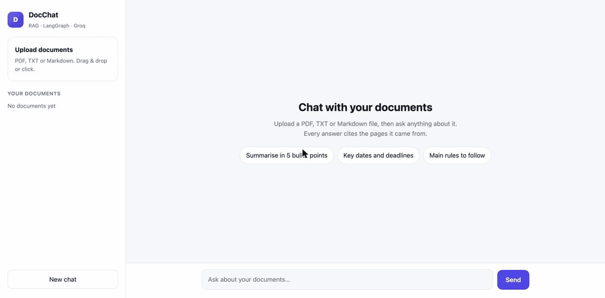
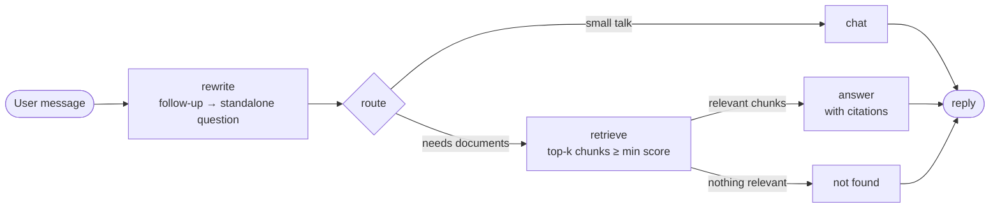

# DocChat: chat with your documents (RAG + LangGraph)

Upload PDFs, text or Markdown files and ask questions about them. Every answer cites the
document and page it came from, follow-up questions keep their context, and questions the
documents can't answer are refused instead of guessed.

**Live demo: [docchat-aem4.onrender.com](https://docchat-aem4.onrender.com)** (free server: after a quiet
period the first visit takes about a minute to wake up; try it with
[the sample handbook](samples/northwind-employee-handbook.pdf)).



## Features

- **Retrieval-augmented answers** with numbered citations (file and page) and the source excerpts one click away
- **Conversation memory**: follow-ups like *"and until when do I have to use them?"* are rewritten into standalone questions before searching
- **Routing**: small talk is answered directly, document questions go through retrieval
- **No hallucinated answers**: if nothing relevant clears the similarity threshold, DocChat says it couldn't find it
- **Per-session isolation**: each browser session has its own documents and chat history
- **FastAPI backend + lightweight web UI** (no build step), with drag-and-drop upload
- **Tested**: graph wiring, ingestion and API are covered by pytest, with the LLM scripted so no API key is needed

## How it works



- **Ingestion**: PDFs are read page by page (`pypdf`), split into ~500-character chunks with overlap, and embedded with `sentence-transformers/all-MiniLM-L6-v2` through `fastembed` (ONNX, no PyTorch, so the whole app runs in under 400 MB of RAM).
- **Retrieval**: cosine similarity over an in-memory vector store; chunks below `MIN_SCORE` are dropped.
- **Generation**: Groq-hosted LLM (default `openai/gpt-oss-20b`) via `langchain-groq`, prompted to answer only from the excerpts and cite them.
- **State**: a LangGraph `StateGraph` with an `InMemorySaver` checkpointer, one thread per session.

| Path | What it does |
| --- | --- |
| `app/graph.py` | LangGraph workflow: rewrite → route → retrieve → answer / not found / chat |
| `app/ingest.py` | File loading (PDF, TXT, MD) and chunking |
| `app/store.py` | Embeddings and per-session vector stores |
| `app/main.py` | FastAPI endpoints and static file serving |
| `web/` | Chat UI (HTML, CSS, vanilla JS) |
| `tests/` | pytest suite |

## Run it locally

Requires Python 3.11+ (developed and tested on 3.14) and a free [Groq API key](https://console.groq.com/keys).

```bash
python -m venv .venv
source .venv/bin/activate
pip install -r requirements.txt

cp .env.example .env          # then paste your GROQ_API_KEY into .env
uvicorn app.main:app --reload
```

Open http://127.0.0.1:8000, upload `samples/northwind-employee-handbook.pdf` (a fictional
handbook) and try:

- *How many days of annual leave do I get, and can I carry unused days over?*
- *And until when do I have to use them?*
- *What is the daily meal limit when travelling?*

The first start downloads the embedding model (about 90 MB) into `.cache/fastembed`.

## API

| Method | Path | Body | Returns |
| --- | --- | --- | --- |
| `POST` | `/api/sessions` | | `{session_id}` |
| `POST` | `/api/sessions/{id}/files` | multipart `files` | `{files: {name: chunk_count}}` |
| `GET` | `/api/sessions/{id}/files` | | `{files}` |
| `POST` | `/api/sessions/{id}/chat` | `{"message": "..."}` | `{answer, sources[], route}` |
| `DELETE` | `/api/sessions/{id}` | | clears documents and history |

Interactive docs are at `/docs` while the server runs.

## Configuration

Set in `.env` (see `.env.example`): `GROQ_MODEL`, `EMBEDDING_MODEL`, `CHUNK_SIZE`, `CHUNK_OVERLAP`,
`TOP_K`, `MIN_SCORE`, `MAX_UPLOAD_MB`, `MAX_CHUNKS_PER_SESSION`, `SESSION_TTL_MINUTES`, `MAX_SESSIONS`.

## Deploy on Render (free)

`render.yaml` describes a free Render web service. In Render, choose **New → Blueprint**, pick
this repository and paste your `GROQ_API_KEY` when asked. The free plan sleeps after about
15 minutes without visitors, so the first visit after that takes about a minute.

## Tests

```bash
pytest
```

## Limitations and next steps

- Documents and chat history live in memory, so a restart clears them. A persistent vector
  store (pgvector, Chroma, Qdrant) and a database-backed checkpointer are the natural next step.
- Scanned PDFs need OCR first; DocChat only reads PDFs that contain text.
- Answers are returned in one piece; streaming tokens to the UI would make long answers feel faster.

---

Built by [Smit Vaghasiya](https://github.com/smitvlog) with Python, LangGraph, LangChain, FastAPI and Groq.
